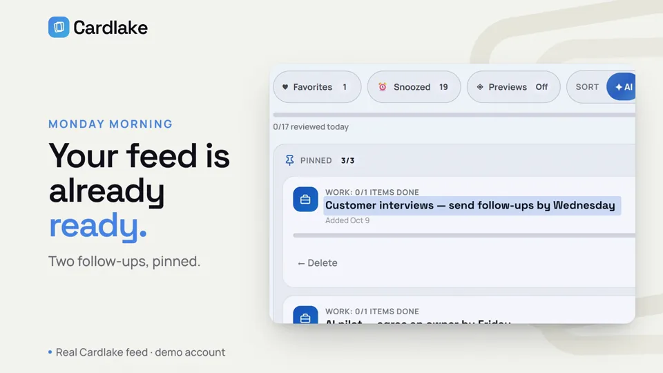

# Cardlake

**Your AI's memory, and you own it.** One daily feed for reminders, learnings,
work and ideas, which you, Claude and ChatGPT all read and write.

[](https://github.com/cardleforall/cardlakeforall/actions/workflows/ci.yml)
[](LICENSE)
[](docs/MCP_SERVER.md)



https://github.com/user-attachments/assets/10d1ce6c-f12a-42bf-aed6-dba16530b934

Open source (AGPL-3.0) and yours to run on Vercel + Neon in a few minutes.

Don't want to host it yourself? Use Cardlake at [cardlake.app](https://cardlake.app).

Cardlake turns everything you don't want to forget (reminders, articles to read, family updates, bookmarks, misc notes, and your GitHub issues) into a single feed, instead of a dozen apps you never open.

## What it does

- **Talk to it from your AI.** Tell Claude or ChatGPT "remind me Wednesday at
  10" or "what's on today?" and it reads and writes your feed over
  [MCP](docs/MCP_SERVER.md). Every card type and action works from chat.
- **One feed for everything.** Reminders, learnings, work items, family
  updates, bookmarks and misc notes, with a progress bar and a streak.
- **Snooze, pin, favorite.** Not today? Snooze a card and it comes back
  when it should. Pin what matters this week.
- **Your GitHub issues as cards**, brought in with one click.
- **Save from any app.** Install it on your phone and share a link or text
  to Cardlake; it becomes a card.
- **Search and attachments.** Find any card; attach photos and files.
- **Yours.** Your own database, your own deployment, one account: yours.
  Open source under AGPL-3.0.

## Why Cardlake

Notes apps, task apps and read-later apps each hold a piece of what you meant
to come back to, and you check none of them. Cardlake is the one place it all
lands, and the place your AI writes to when
you ask it to remember something. Because it runs on your own Vercel and
Neon accounts, what you and your AI save stays with you.

## Why a feed, not folders

Capture, one vault, review, and streaks each map to how memory and habits work. An open loop costs attention until it's captured somewhere trustworthy, one system beats maintaining seven, and unreviewed things fade fast unless something resurfaces them.

## Run your own

Your own Cardlake, free on Vercel's and Neon's free plans, in about 10 minutes.
You won't need a terminal, a password generator or Google Cloud.

1. **Sign up at Vercel first,** at [vercel.com/signup](https://vercel.com/signup):
   choose **Continue with GitHub**. No GitHub account yet? GitHub's sign-in
   page has **Create an account** ([github.com/signup](https://github.com/signup)),
   then brings you back. Cardlake's code will live in your GitHub account, in
   your own copy. The free Hobby plan is enough. Finish everything Vercel asks,
   including verifying your account, until it shows its dashboard.
2. **Then come back here and click the button:**

   [](https://vercel.com/new/clone?repository-url=https%3A%2F%2Fgithub.com%2Fcardleforall%2Fcardlakeforall&project-name=cardlake-self-hosted&repository-name=cardlake-self-hosted&stores=%5B%7B%22type%22%3A%22integration%22%2C%22integrationSlug%22%3A%22neon%22%2C%22productSlug%22%3A%22neon%22%7D%2C%7B%22type%22%3A%22blob%22%2C%22access%22%3A%22private%22%7D%5D)

   Vercel then asks you a few things. Accept what it suggests, or rename the
   project and repository if you like:
   - **Create Git Repository:** keeps a copy of Cardlake in your GitHub account.
   - **Neon:** your database. Choose the free plan and create it.
   - **Blob:** where files you attach to cards are kept. Create it.

   Then click **Deploy** and wait a minute or two. If Vercel shows its
   dashboard instead of your new project, come back and click the button again.

3. **Open your site and set your password.** When Vercel says it's done,
   click the picture of your site, or **Visit**. Cardlake asks for your name,
   email and a password: this is your account. **Do this right away:** for
   your security, setup is open for one hour after your site first starts,
   then it locks, so nobody else can claim it. (Missed it? The setup page
   explains how to reopen it.)

4. **Optional: connect Claude or ChatGPT.** In Cardlake, click **Connect AI**
   and follow the steps. Your assistant can then read and add cards for you.

**It's yours alone.** Your Cardlake has one account, yours. There's nobody to
administer: no sign-up, no user list, no invites. Sign in with the same
email and password on your phone and other computers.

**Forgot your password?** In Vercel, open your project, then **Settings** and
**Environment Variables**. Add `CARDLE_SETUP_OPEN` with the value `1`, save,
and redeploy (**Deployments**, **⋯**, **Redeploy**). Open `/setup` on your
site and set a new password with the same email: you keep all your cards.
Then delete `CARDLE_SETUP_OPEN` and redeploy again.

**Getting updates.** Your copy doesn't update by itself. When a new version
is out, Cardlake shows **Update available** at the top; it leads to your
Cardlake's `/updates` page. The first time, click **Turn on
updates** there: GitHub opens with the update file filled in, ready to commit. After
that, to get the latest Cardlake, open your copy on GitHub, then **Actions**,
**Update Cardlake** and **Run workflow**. Vercel deploys the new version a
minute or two later, and you keep all your cards. If you've changed the code
yourself, it stops rather than erase your changes. To also hear about new
versions by email, open [Cardlake on GitHub](https://github.com/cardleforall/cardlakeforall) and
choose **Watch**, **Custom**, **Releases**.

**Everything else is optional.** Cardlake makes its own secret keys and sets
up its own database. [docs/ENVIRONMENT.md](docs/ENVIRONMENT.md) lists the
settings you can add later, such as a custom domain, and
[docs/ADMIN.md](docs/ADMIN.md) covers running it.

## Quick start (local development)

```bash
git clone https://github.com/cardleforall/cardlakeforall.git
cd cardlakeforall
npm ci
cp .env.example .env.local   # fill in the values -- see docs/ENVIRONMENT.md
npm run dev
```

This starts a local dev server at `http://localhost:3000` that serves `public/` statically and routes `/api/*` to the same handler files Vercel uses in production; no separate build step, no `vercel dev` required. Point `DATABASE_URL` at a database of your own, never one with real data.

## Development

```bash
npm ci
npm test
```

`npm run build:vault` validates the committed shell and accepts `--target` for tests. Outside services that feed cards in (currently GitHub Issues) are integrations; [docs/INTEGRATIONS.md](docs/INTEGRATIONS.md) covers how they work and how to add one. See [.env.example](.env.example) and [docs/ENVIRONMENT.md](docs/ENVIRONMENT.md) for what each environment variable does.

`npm test` covers the build; the actual test suite (`tests/unit/` offline unit tests, `tests/sit/` system integration tests against a deployment) is run separately via `npm run test:lite` / `npm run test:full`; see [tests/README.md](tests/README.md) for the unit/SIT split and when to run which tier.

## Architecture

- **Frontend**: `public/vault/index.html` is a committed, hand-maintained shell (not generated from markdown or any other source), progressively enhanced with plain JS in `public/vault/assets/`.
- **Backend**: Vercel serverless functions in `api/`, consolidated per resource area to stay within Vercel's Hobby function-count limit (see `.vercelignore` and the comments in `api/vault.js` / `api/auth.js`).
- **Sign-in**: one owner with a password, set at `/setup` (see [docs/ADMIN.md](docs/ADMIN.md)).
- **Uploads**: Server-side format checks and an explicit allowlist apply to files and attachments; see [supported formats and limits](docs/UPLOADS.md).
- **Database**: Neon Postgres. Schema lives in `schema-v2.sql` and applies itself on the first request after a deploy.
- **MCP server**: `api/mcp.js` + `api/_lib/mcp-tools.js` expose every card type and feed action (snooze, pin, favorite) to any MCP-compatible AI assistant. See [docs/MCP_SERVER.md](docs/MCP_SERVER.md).

## Deployment

Deployment is GitHub-to-Vercel: pushes to the connected `main` branch create production deployments; pull requests create previews. See [DEPLOY.md](DEPLOY.md).

## Contributing

Issues are welcome; pull requests aren't accepted. See [CONTRIBUTING.md](CONTRIBUTING.md) for why, and for setting up and testing your own copy. Please also read the [Code of Conduct](CODE_OF_CONDUCT.md).

## License

Cardlake is free software under the [GNU AGPL-3.0](LICENSE). You can use, change and run it freely. If you run a modified version as a service for other people, you must offer them its source under the same license.

Cardlake™ is a trademark of the project's maintainer. The license covers the code, not the name: run your own copy as you like, but please don't offer a service to other people under the name Cardlake.

Security issues: please report them privately, see [SECURITY.md](SECURITY.md).
