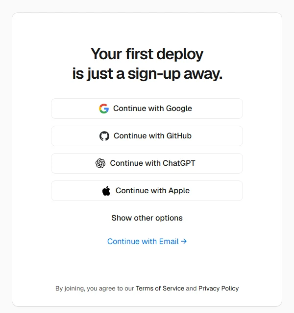
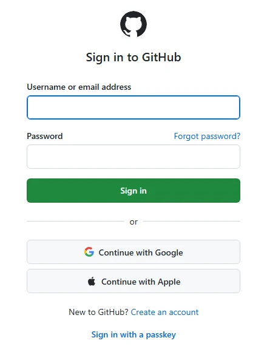
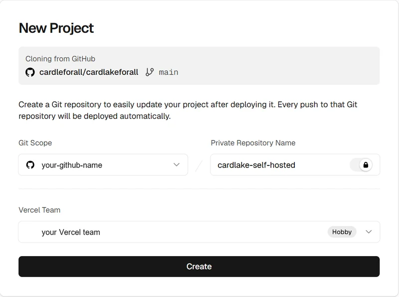

# Set up your own Cardlake, step by step

About 10 minutes, free, and no terminal. You'll make two accounts (Vercel,
and GitHub if you don't have one), click one button, and set a password.

Vercel and GitHub change their screens now and then, so yours may look a
little different. The buttons named here stay the same.

## 1. Sign up at Vercel, with GitHub

Vercel runs your Cardlake. GitHub keeps your copy of its code, which is how
you get updates later.

Open [vercel.com/signup](https://vercel.com/signup) and click
**Continue with GitHub**.

**Already have a GitHub account?** Sign in, click **Authorize Vercel**, and
go on to "Finish Vercel's sign-up" below.

**No GitHub account yet?** On GitHub's sign-in page, click
**Create an account**. GitHub asks for an email, a password and a username,
then emails you a code to type in. When you're done, it takes you back to
Vercel. GitHub's own guide:
[Creating an account on GitHub](https://docs.github.com/en/account-and-profile/how-tos/account-management/creating-an-account-on-github).

**Finish Vercel's sign-up.** Vercel asks a few questions:

- **Plan:** choose **Hobby**. It's free and enough for Cardlake.
- **Your name.**
- **A code:** Vercel may send you a short code to check you're a real
  person. Type it in.

Keep going until Vercel shows its dashboard ("Start building" or "Import Git
Repository"). Don't import anything there: come back to this page instead.

## 2. Click Deploy

Vercel shows **New Project**, with your GitHub name already filled in.
Leave it as it is and click **Create**.

- **GitHub asks to install Vercel?** Allow it. That's what lets Vercel put
  your copy in your GitHub account.
- **Vercel shows its dashboard instead of New Project?** That happens right
  after signing up. Come back here and click **Deploy** again.

## 3. Add the database and file storage

Vercel then shows **Add Products** with two things to add. Both are free.

- **Neon** is your database, where your cards live. Click **Add**, accept
  Neon's terms, choose the **Free** plan and a region near you, then
  **Create**.
- **Blob** is where files you attach to cards are kept. Click **Add**, then
  **Create**.

## 4. Deploy

Click **Deploy** and wait a minute or two. When Vercel says it's done, click
the picture of your site, or **Visit**.

## 5. Set your password, right away

Your Cardlake opens on **Set up your Cardlake**. Enter your name, email and
a password: this is your account, and the only one.

Do this right away. For your security, setup stays open for one hour after
your site first starts, then locks so nobody else can claim it. Missed it?
The setup page explains how to reopen it.

## That's it

- **Bookmark your site.** Its address is on your Vercel dashboard.
- **Connect Claude or ChatGPT** (optional): in Cardlake, click
  **Connect AI**.
- **Updates:** when a new version is out, Cardlake shows
  **Update available** at the top. Click it and follow the steps.

Stuck? [Open an issue](https://github.com/cardleforall/cardlakeforall/issues)
and say which step, with a screenshot if you can.
